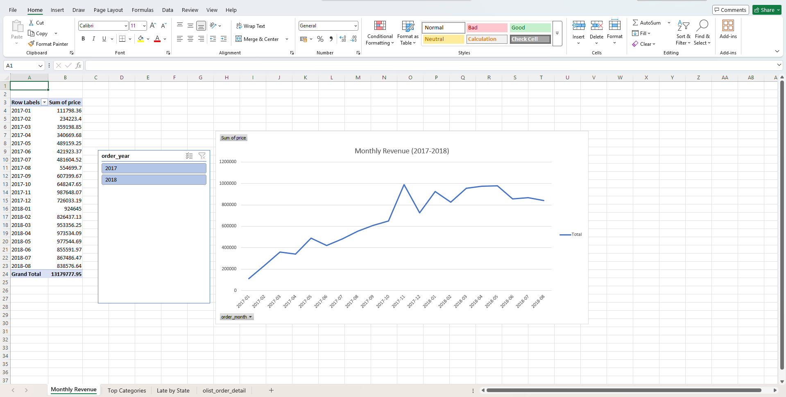
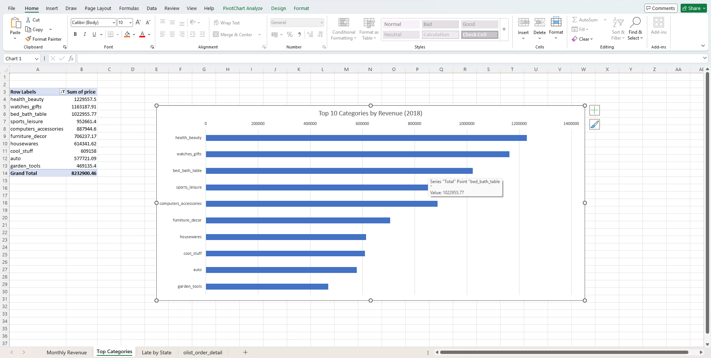
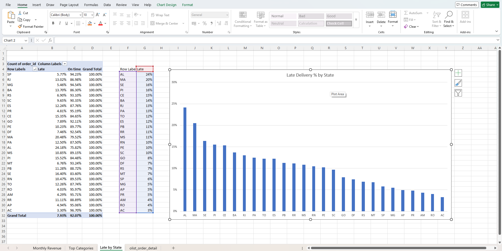
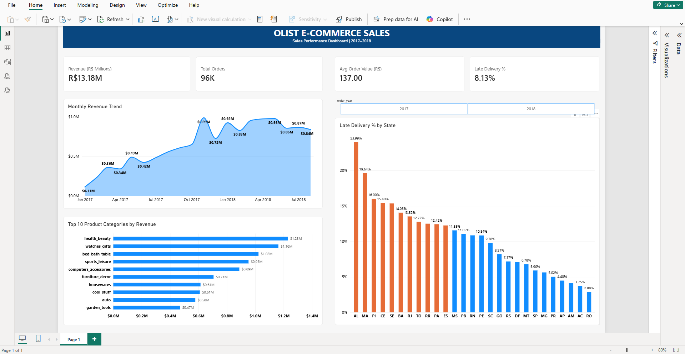

# Olist E-Commerce Sales Analysis (MySQL + Excel + Power BI)

An end-to-end data analysis of a Brazilian online marketplace. The project answers business questions about revenue growth, product categories, regional performance, customer retention and delivery performance.

---

## 1. Business Problem

Olist is a Brazilian e-commerce marketplace that connects small businesses to customers. A management team would want to know:

1. How much revenue does the business make, and how is it growing?
2. Which product categories and which states drive the most sales?
3. Do customers come back and buy again?
4. How reliable is delivery, and where does it fail?

---

## 2. Dataset

- Source: [Brazilian E-Commerce Public Dataset by Olist (Kaggle)](https://www.kaggle.com/datasets/olistbr/brazilian-ecommerce)
- About 100,000 orders placed between 2016 and 2018
- Tables used: `customers`, `orders`, `order_items`, `products`, `product_category_name_translation`
- Raw CSV files are not stored in this repo (see Kaggle link above)

---

## 3. Tools

| Tool | Used for |
|------|----------|
| MySQL 8 | Creating tables, loading data, writing analysis queries (joins, CTEs, window functions) |
| Excel | Pivot tables, charts, slicer for quick analysis |
| Power BI | Interactive dashboard with KPIs, DAX measures and slicers |

---

## 4. Project Workflow

1. Downloaded the dataset from Kaggle
2. Created a MySQL database and 5 tables, then loaded the CSV files with `LOAD DATA LOCAL INFILE`
3. Wrote 10 SQL queries to answer the business questions
4. Exported one order-level dataset (about 110K rows, Jan 2017 to Aug 2018) from MySQL to CSV
5. Built 3 pivot tables and charts in Excel, with a year slicer
6. Loaded the same dataset into Power BI, created DAX measures and built a one-page dashboard with KPI cards, charts and a year slicer

---

## 5. Repository Structure

```
olist-sales-analysis/
├── README.md
├── sql/
│   └── olist_project.sql        (table setup, data loading, 10 analysis queries)
├── excel/
│   └── olist_analysis.xlsx      (pivot tables and charts)
├── powerbi/
│   └── olist_dashboard.pbix     (Power BI dashboard)
└── screenshots/
    ├── monthly_revenue.png
    ├── top_categories.png
    ├── late_by_state.png
    └── dashboard.png
```

---

## 6. SQL Analysis

Revenue is defined as the sum of item prices for **delivered** orders only (freight not included). All amounts are in Brazilian reais (R$).

| # | Question | Techniques |
|---|----------|------------|
| Q1 | Overall KPIs (revenue, orders, customers, average order value) | JOIN, aggregation |
| Q2 | Monthly revenue and order count | DATE_FORMAT, GROUP BY |
| Q3 | Month-over-month revenue growth | CTE, LAG() window function |
| Q4 | Top 10 products by revenue | JOIN, LEFT JOIN |
| Q5 | Top 10 categories by revenue | JOIN with translation table |
| Q6 | Revenue by state | GROUP BY |
| Q7 | Average order value by state | Aggregation |
| Q8 | Repeat customer rate | CTE, conditional counts |
| Q9 | Average delivery days by state | DATEDIFF |
| Q10 | Late delivery rate | Conditional aggregation |

---

## 7. Key Metrics

| Metric | Value |
|--------|-------|
| Total revenue (delivered orders) | R$13.22M |
| Delivered orders | 96,478 |
| Unique customers | 93,358 |
| Average order value | R$137.04 |
| Repeat customer rate | 3.0% (2,801 customers) |
| Late deliveries | 8.11% (7,826 of 96,470 delivered orders) |

---

## 8. Key Insights

1. **Fast growth in 2017, then a plateau.** Monthly revenue grew from about R$112K in January 2017 to about R$988K in November 2017 (roughly 9x). In 2018 it stayed between about R$826K and R$978K per month.
2. **November 2017 was the peak month.** Revenue was R$987,765 from 7,289 orders, 52% above October. This is consistent with Black Friday, though the data alone does not prove the cause. December then fell about 26%.
3. **Strong year-over-year growth.** May 2018 revenue was about double May 2017, and August 2018 was about 51% above August 2017.
4. **Three categories drive about a quarter of revenue.** health_beauty (R$1.23M), watches_gifts (R$1.17M) and bed_bath_table (R$1.02M) make up about 26% of revenue. The top 10 categories make up about 62%.
5. **Order value differs a lot by category.** watches_gifts earns about R$212 per order, while bed_bath_table earns about R$110 per order, even though bed_bath_table has more orders.
6. **Revenue is concentrated in three states.** SP (R$5.07M), RJ (R$1.76M) and MG (R$1.55M) together generate about 63% of revenue. SP alone is about 38% of revenue and 42% of orders.
7. **Very low customer retention.** Only 3.0% of customers placed more than one order.
8. **Delivery time varies widely by region.** São Paulo averages 8.7 days, while the remote northern states are slowest: RR 29.3, AP 27.2, AM 26.4, AL 24.5 and PA 23.7 days. RJ, the second-largest market, averages 15.2 days.
9. **Late deliveries are concentrated in the north-east and in RJ.** Late rates (share of order lines, Jan 2017 to Aug 2018): AL 24.2%, MA 20.5%, SE 16.4%, PI 15.5%, CE 15.4% and RJ 13.0%, compared with SP at 5.8%.
10. **Slow is not always late.** The remote northern states (AC, RO, AM, AP) have long delivery times but low late rates (3% to 5%), which suggests their estimated delivery dates already allow for the distance.

---

## 9. Recommendations

1. **Improve retention.** With only 3% repeat customers, loyalty offers, follow-up emails and post-purchase discounts could be the biggest growth lever.
2. **Fix delivery in the north-east and in RJ.** Review carriers and logistics in AL, MA, SE, PI, CE and RJ, where late rates are 2 to 4 times higher than in SP.
3. **Reduce dependence on one region.** Grow in mid-sized states (for example BA, PE, CE) so revenue is less tied to SP, RJ and MG.
4. **Plan for seasonality.** Prepare stock and logistics for November peaks, and look at what drove the drop in December.
5. **Push higher-value categories.** Promote categories with a high order value (for example watches_gifts) alongside high-volume ones.

---

## 10. Excel Analysis

Built from the exported order-level dataset (109,873 rows, January 2017 to August 2018):

- **Monthly Revenue** pivot with a line chart and a year slicer
- **Top Categories** pivot filtered to the top 10, with a bar chart
- **Late by State** pivot showing the share of late vs on-time order lines per state, with a chart





---

## 11. Power BI Dashboard

DAX measures used:

```
Total Revenue = SUM(olist_order_detail[price])
Total Orders = DISTINCTCOUNT(olist_order_detail[order_id])
Avg Order Value = DIVIDE([Total Revenue], [Total Orders])
Late Delivery % = DIVIDE(CALCULATE(DISTINCTCOUNT(olist_order_detail[order_id]), olist_order_detail[delivery_status] = "Late"), [Total Orders])
Avg Delivery Days = AVERAGE(olist_order_detail[delivery_days])
```

The dashboard is one page (Jan 2017 to Aug 2018) with:

1. **Four KPI cards:** Revenue (R$13.18M), Total Orders (96K), Average Order Value (R$137.00) and Late Delivery % (8.13%)
2. **Monthly Revenue Trend** (area chart by month)
3. **Top 10 Product Categories by Revenue** (bar chart)
4. **Late Delivery % by State** (column chart sorted from highest to lowest; states above 12% are highlighted in orange)
5. **Year slicer** (2017 / 2018) that filters every visual



---

## 12. Assumptions and Limitations

- Revenue means item price for delivered orders. Freight and cancelled or unavailable orders are excluded.
- A delivery is "late" when it arrived after the estimated delivery date.
- The SQL queries cover the full dataset (2016 to 2018). The Excel and Power BI analysis covers January 2017 to August 2018, because 2016 has very few orders and the data ends in August 2018.
- Patterns shown here (for example slow delivery and low sales in the same states) are correlations, not proof of cause.
- Some states have very few orders (for example AC with 80 and AP with 67), so their percentages are less reliable.
- The Excel late-delivery percentages count order lines, while the Power BI measure counts distinct orders, so the state percentages differ slightly between the two.
- Review scores were not analysed, so no claim is made about delivery and customer satisfaction.

---

## 13. How to Reproduce

1. Download the dataset from Kaggle and place the CSV files in a folder (for example `C:/olist/`)
2. Open `sql/olist_project.sql` in MySQL Workbench, update the file paths in Part 2, and run Part 1 and Part 2
3. Run the queries in Part 3
4. Export the order-level query result to CSV and open it in Excel or Power BI

---

## 14. Author

[Mir Musraf Ali] | [www.linkedin.com/in/mir-musraf-ali] | [mirmusrafali35@gmail.com]
